<p align="center"></p>

<h3 align="center">Hundreds of personal internship emails. Zero sent without your approval.</h3>

<p align="center">An AI assistant researches labs, professors and companies, writes one honest email per person from your real facts, and saves it as a draft. You read it and type <code>send</code>. Apple Mail or Outlook does the rest.</p>

<p align="center"><b>For students</b> applying to many labs and companies · <b>for builders</b> who want a safe pattern for AI agents that touch email</p>

<p align="center">
<a href="https://github.com/aghasalim/internship_autopilot/actions/workflows/checks.yml"></a>
<a href="LICENSE"></a>


<a href="https://github.com/aghasalim/internship_autopilot/stargazers"></a>
</p>

<p align="center">
<a href="#overview">Overview</a> · <a href="#why">Why</a> · <a href="#architecture">Architecture</a> · <a href="#workflow">Workflow</a> · <a href="#safety">Safety and ethics</a> · <a href="#setup">Setup</a> · <a href="#usage">Usage</a> · <a href="#examples">Examples</a> · <a href="#troubleshooting">Troubleshooting</a> · <a href="#faq">FAQ</a>
</p>

## Overview

<p align="center">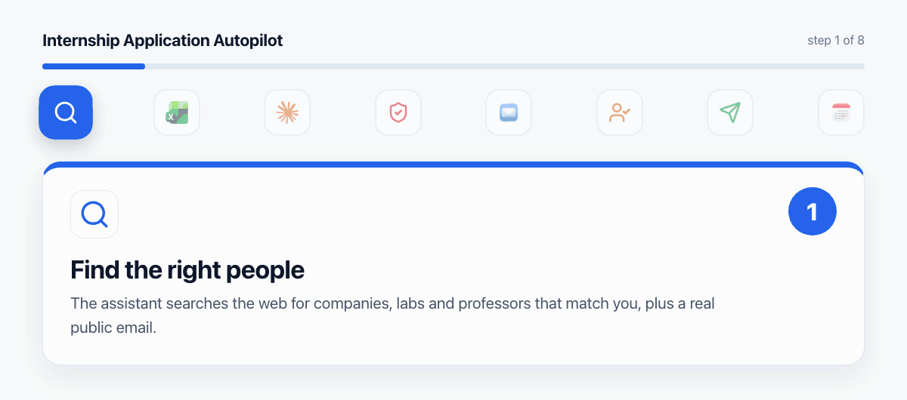</p>

An AI assistant does the slow parts of an internship search. You make the one decision that matters.

* **Research:** finds companies, labs and professors, with a real public contact address and the page it came from.
* **Tailoring:** one master CV plus a short email per person (under 170 words) with one detail of their work and one matching project of yours.
* **Honesty:** every sentence is checked against your facts file. Inflated claims are removed.
* **Drafts first:** emails are saved as drafts with your current CV attached.
* **You approve:** nothing is sent until you type `send`.
* **Two senders:** Apple Mail on a Mac (AppleScript) or classic Outlook on a Windows PC (PowerShell and Outlook COM).
* **After sending:** replies are summarised with a drafted answer, meetings go into Apple Calendar, and every decision is logged.

**In the real run:** hundreds of emails to professors and labs, about 30 companies in Boston, a cap of 100 emails a day, and several positive replies and interviews.

### Try it in ten seconds

No Mac, Outlook or AI needed. Clone the repo and run the draft checker on a good and a bad email:

```bash
git clone https://github.com/aghasalim/internship_autopilot.git
cd internship_autopilot
python3 scripts/check_draft.py examples/draft_generic.txt examples/facts.md
```

It flags the generic greeting, the missing opt out line, the invented "300%" and the inflated claim. Then run it on `examples/draft_quill.txt` and watch it pass.

**If this helps your search, a star helps other students find it.**


## Why

<p align="center">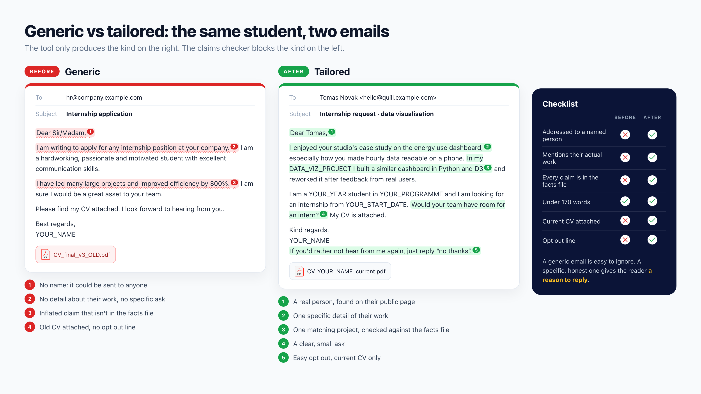</p>

Generic applications are easy to ignore. Specific, honest ones get answers. Writing them by hand for hundreds of people takes weeks. This project keeps the quality of a handwritten email and removes the busywork, without ever giving up control over what gets sent.

## Architecture

<p align="center">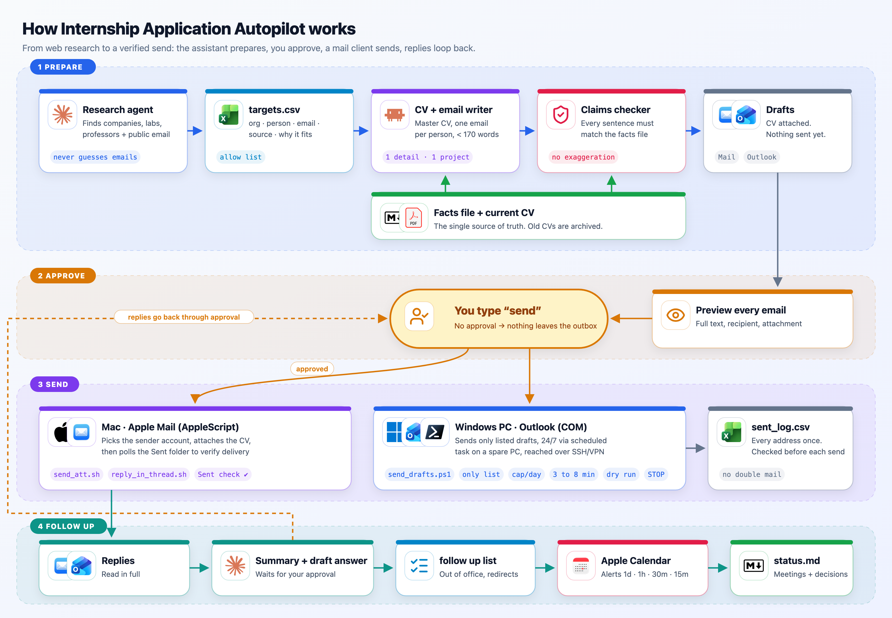</p>

Four layers, left to right and top to bottom:

1. **Prepare:** research agent, `targets.csv`, CV and email writer, claims checker, drafts. The facts file and the current CV feed the writer and the checker.
2. **Approve:** a preview of every email, then your `send`.
3. **Send:** `send_att.sh` on the Mac or `send_drafts.ps1` on a Windows PC. Both write to `sent_log.csv`.
4. **Follow up:** replies, a follow up list, Apple Calendar and `status.md`. Replies go back through approval.

A vector version is in [`assets/images/architecture.svg`](assets/images/architecture.svg).

## Workflow

<p align="center">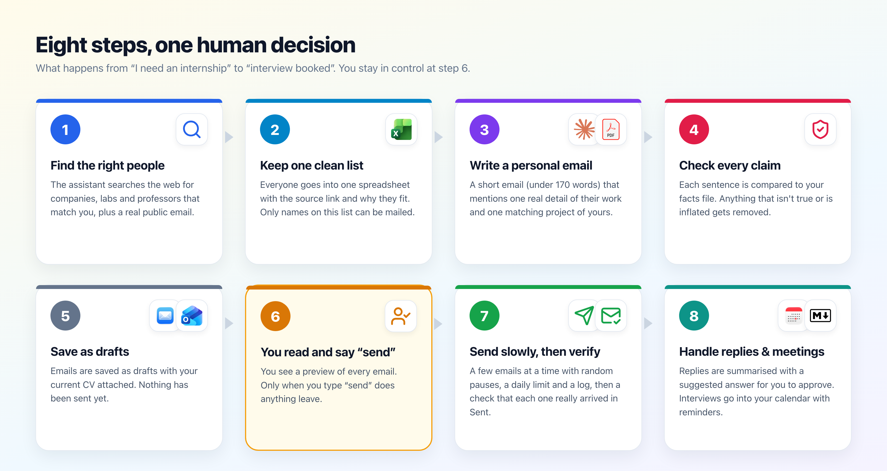</p>

Eight steps, one human decision. The detailed message flow, with 21 numbered steps, is in the sequence diagram under [Usage](#usage).

<a name="safety"></a>

## Safety and ethics

<p align="center">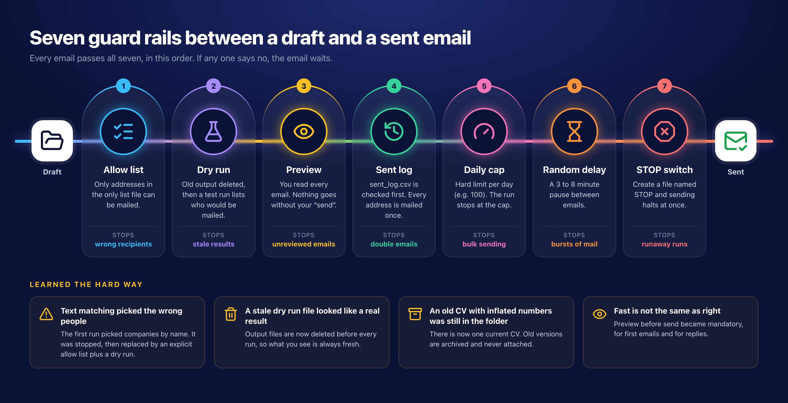</p>

Every email passes seven guard rails, in this order: **allow list**, **dry run**, **preview and send**, **sent log**, **daily cap**, **random delay** and **STOP switch**. Each one exists because something nearly went wrong once:

* A first run matched companies by name and would have mailed the wrong people. It was stopped and replaced by an explicit allow list plus a dry run.
* A stale dry run file once looked like a real result. Output is now deleted before every run.
* An old CV with inflated numbers was still in the folder. There is now one current CV, and old versions are archived.
* Preview before send became mandatory, for first emails and for replies.

**This is a tool for personal, low volume, individually written applications. It is not for mass mailing.**

* Keep volumes low and send only to people whose work truly matches yours.
* Include an easy opt out line and honour every "no thanks" at once.
* Respect GDPR and CAN SPAM. Use only public business contact data, keep only what you need, and delete it when your search ends.
* Never send without human approval. Never fake credentials, numbers or achievements.

Read the full rules in [`docs/ethics.md`](docs/ethics.md). This is guidance, not legal advice.

## Setup

<p align="center"></p>

**What you need**

* An AI assistant that can browse the web, read files and run commands (for example Claude Code)
* A Mac with Apple Mail and Calendar, or a Windows PC with classic Outlook (the new Outlook has no COM support), or both
* Python 3 for the two checkers

**First steps for both**

1. Copy [`templates/ASSISTANT_INSTRUCTIONS.md`](templates/ASSISTANT_INSTRUCTIONS.md) into your assistant's project instructions.
2. Make a `data/` folder (it is in `.gitignore`) and copy [`templates/facts.md`](templates/facts.md) into it. Fill it in honestly.
3. Put your one current CV in `data/cv/` and move old versions to `data/cv/archive/`.

Then follow [`docs/setup_mac.md`](docs/setup_mac.md) or [`docs/setup_windows.md`](docs/setup_windows.md).

## Usage

<p align="center">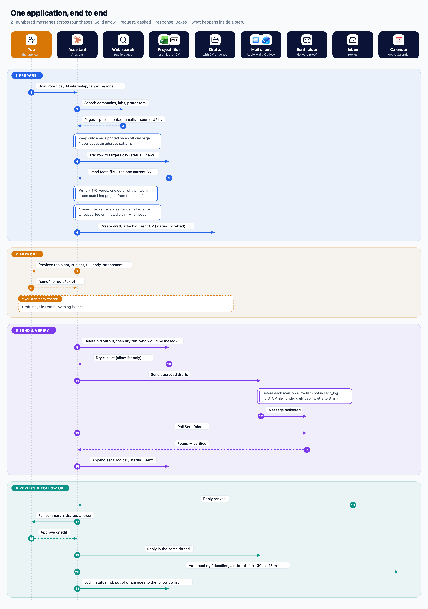</p>

Tell the assistant what you are looking for, then work through the phases:

1. **Prepare.** "Find 10 robotics labs that match my facts file." Review `targets.csv` and add the ones you agree with to `only_list.txt`.
2. **Approve.** The assistant shows a preview per draft. Answer `send`, `edit` or `skip`.
3. **Send and verify.**

   On a Mac, one approved email at a time:
   ```bash
   scripts/mac/send_att.sh you@example.com a.rivera@northwind.example.com "Internship request" data/draft.txt data/cv/CV_YOUR_NAME_current.pdf "Northwind Robotics"
   ```
   On Windows, a dry run first, then the real run:
   ```powershell
   .\send_drafts.ps1 .\only_list.txt 100
   .\send_drafts.ps1 .\only_list.txt 100 Send
   ```
4. **Replies and follow up.** The assistant summarises each reply and drafts an answer. After your approval it replies in the thread, adds meetings to the calendar and updates `status.md`.
   ```bash
   scripts/mac/add_event.sh "Internship" "[INT] Harbor AI · technical interview" 2026/10/21 09:00 90 "Prepare ROS 2 demo"
   ```

To stop at any moment, create a file called `STOP` next to the script.

## Examples

<p align="center">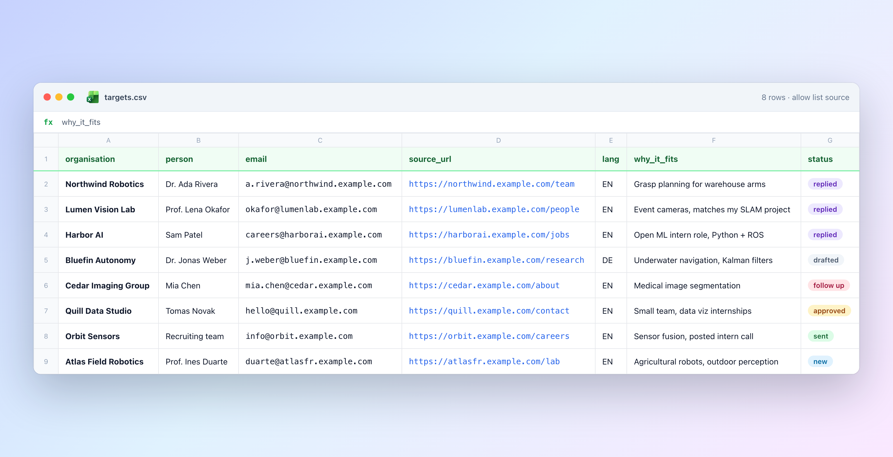</p>

<table>
<tr>
<td width="50%">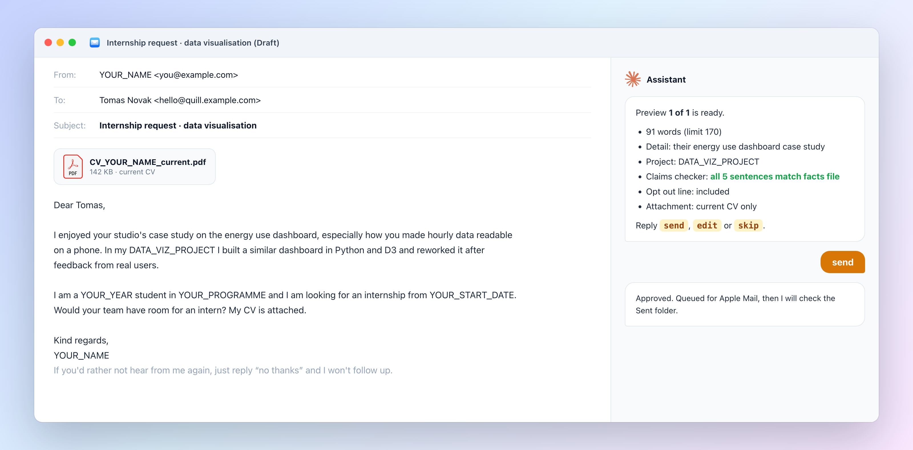</td>
<td width="50%">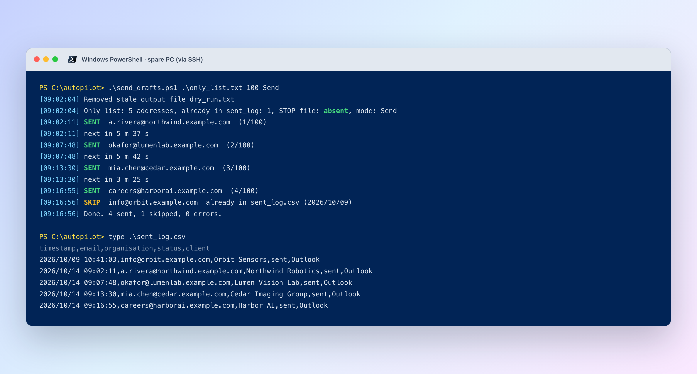</td>
</tr>
<tr>
<td width="50%">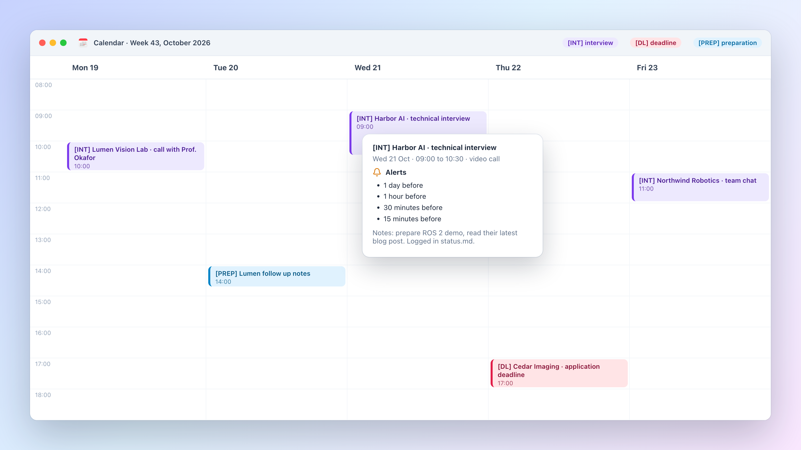</td>
<td width="50%">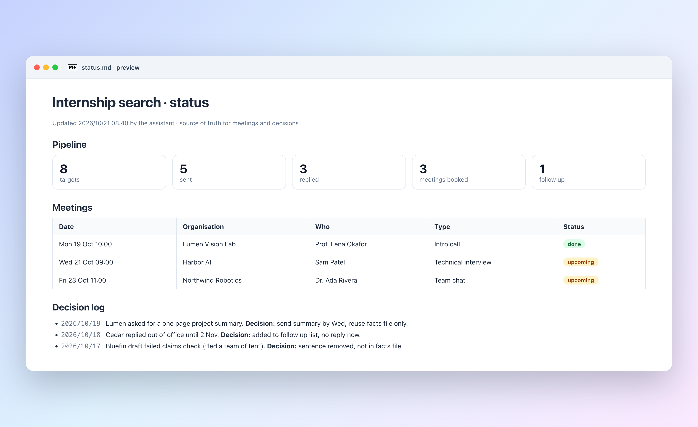</td>
</tr>
</table>

All example data is fictional and lives in [`examples/`](examples). Every address ends in `example.com`. Try the draft checker on a good and a bad email:

```bash
python3 scripts/check_draft.py examples/draft_quill.txt examples/facts.md
python3 scripts/check_draft.py examples/draft_generic.txt examples/facts.md
```

## Troubleshooting

<p align="center"></p>

Most answers are in the script output. Read it first.

* **"Not authorised to send Apple events"**: open System Settings, Privacy and Security, Automation, and allow Terminal to control Mail and Calendar.
* **`NOT VERIFIED` on the Mac**: the message did not reach Sent within two minutes. Check the Outbox and whether the account is online. Do not resend before you have checked.
* **`SKIP ... already in sent_log.csv`**: this is the guard rail working. Each address is mailed once.
* **`STOP file present`**: delete the `STOP` file when you want to continue.
* **Nothing sent on Windows**: the default mode is DryRun. Add `Send`, and only after reading `dry_run.txt`.
* **Outlook COM error 80080005**: Outlook and PowerShell run as different users or with different rights. Start both normally, not as administrator.
* **The scheduled task runs but sends nothing**: the user must be logged on (a locked screen is fine) and classic Outlook must be installed.
* **Strange characters in the PowerShell window**: use Windows Terminal, or set the console to UTF8 with `chcp 65001`.

## FAQ

<p align="center">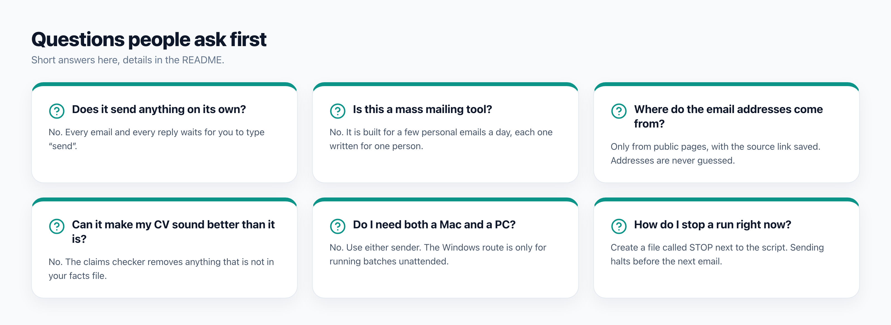</p>

**Which AI assistant does it need?** Any assistant that can browse, read files and run commands. The instructions file is plain Markdown.

**Can I use Gmail or another client?** The scripts drive Apple Mail and Outlook. Both can send through a Gmail or university account that is added to them.

**Why a Windows PC at all?** It can run batches every day without your laptop. Reach it over SSH through a private VPN such as Tailscale.

**Why 100 a day and 3 to 8 minutes apart?** Low volume and human pacing protect your account and the people you write to. Lower is better.

**Is my data published?** No. Real CSV files, CVs, logs and `data/` are in `.gitignore`. Run `python3 scripts/check_private.py` before every push.

## Repository

```text
internship_autopilot/
├── README.md
├── assets/images/        images used in this README
├── assets/src/           sources that rebuild every image (build.sh)
├── docs/                 setup, ethics, sanitisation checklist
├── examples/             fictional example data
├── scripts/mac/          send_att.sh, reply_in_thread.sh, add_event.sh
├── scripts/windows/      send_drafts.ps1, install_task.ps1
├── scripts/              check_draft.py, check_private.py
└── templates/            assistant instructions, facts, email, reply, status
```

## License and credits

[MIT](LICENSE) © aghasalim. See [`CONTRIBUTING.md`](CONTRIBUTING.md) and [`SECURITY.md`](SECURITY.md).

Apple, Apple Mail, Apple Calendar, macOS, Microsoft, Windows, Outlook, Excel, PowerShell, Tailscale and Claude are trademarks of their owners. Their logos appear only to show which apps the scripts work with. This project is not affiliated with or endorsed by any of them. Line icons are from [Lucide](https://lucide.dev) (ISC license). Image sources and credits are in [`assets/src/README.md`](assets/src/README.md).
