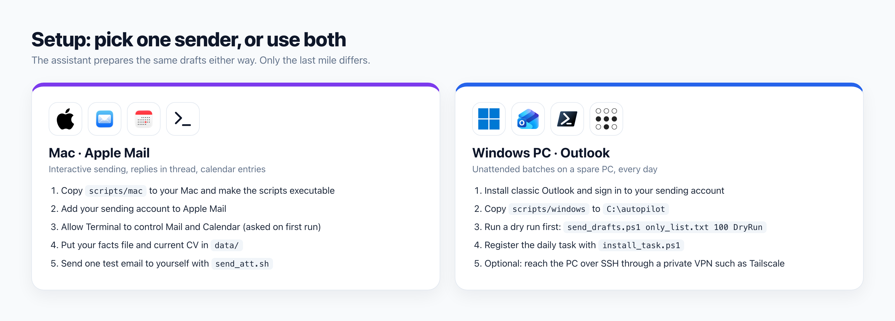

# Setup on a Mac (Apple Mail and Calendar)

<p align="center"></p>

## 1. Prepare

* Add your sending account to Apple Mail and send one normal email by hand, so you know it works.
* Make a calendar for the search, for example `Internship`, in Apple Calendar.
* Create the private data folder next to the repository files:

```bash
mkdir data data/cv data/cv/archive
cp templates/facts.md data/facts.md
chmod +x scripts/mac/*.sh
```

## 2. Allow automation

The first time a script runs, macOS asks whether Terminal may control Mail (and Calendar). Click **OK**. If you clicked no, open System Settings, Privacy and Security, Automation, and turn it on there.

## 3. Test without sending

```bash
echo "Test body" > data/test.txt
DRY_RUN=1 scripts/mac/send_att.sh you@example.com you@example.com "Test" data/test.txt data/cv/CV_YOUR_NAME_current.pdf
```

You should see `DRY RUN  would send "Test" ...`.

## 4. Send one real test to yourself

```bash
scripts/mac/send_att.sh you@example.com you@example.com "Test" data/test.txt data/cv/CV_YOUR_NAME_current.pdf
```

The script sends, then polls the Sent folder for up to two minutes and prints `SENT ... (verified in Sent folder)`. It also adds a line to `scripts/mac/sent_log.csv`. Remove that test line afterwards, or that address will be skipped from now on.

## Settings

All settings are environment variables, so the commands stay short:

<table>
<tr><th>Variable</th><th>Default</th><th>Meaning</th></tr>
<tr><td><code>DRY_RUN</code></td><td>0</td><td>1 prints what would happen and sends nothing</td></tr>
<tr><td><code>SENT_LOG</code></td><td>next to the script</td><td>where sent addresses are logged</td></tr>
<tr><td><code>STOP_FILE</code></td><td>next to the script</td><td>if this file exists, nothing is sent</td></tr>
<tr><td><code>WAIT_SECONDS</code></td><td>120</td><td>how long to wait for the Sent folder check</td></tr>
</table>

## The three scripts

* `send_att.sh`: one new email with the CV attached, from a chosen sender account, verified in Sent.
* `reply_in_thread.sh`: replies to the newest message from a person in the same thread, verified in Sent.
* `add_event.sh`: adds a meeting or deadline to Apple Calendar with alerts 1 day, 1 hour, 30 minutes and 15 minutes before.
